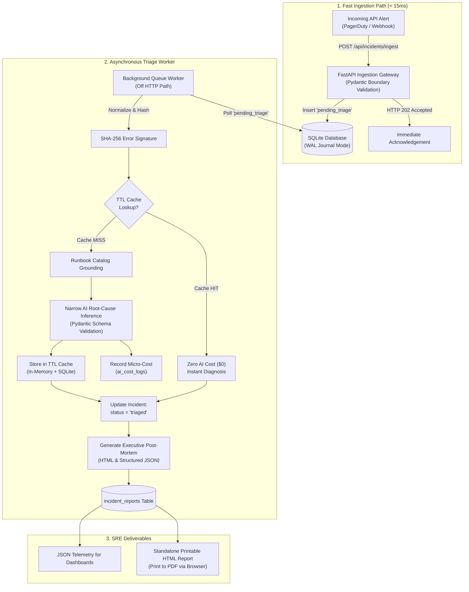

# IncidentPulse — Autonomous API Incident Triage & Post-Mortem Engine

> **FlyRank AI Internship · Backend Track · Capstone: "Your 10x Solution"**  
> **Candidate:** Deepak Prajapati  
> **Portfolio:** [internship-badge.netlify.app/verify/deepakprajapati](https://internship-badge.netlify.app/verify/deepakprajapati)  
> **GitHub:** [github.com/deepakprajapati8938-del](https://github.com/deepakprajapati8938-del)  
> **Stack:** Python 3.11 · FastAPI · SQLite (WAL Mode) · Pydantic v2 · JWT · 100% $0 Cost  

---

## 1. The 10x Transformation Claim

| Metric | Manual SRE Baseline | IncidentPulse 10x Solution | Improvement |
|---|---|---|---|
| **Incident Ingestion** | SRE receives pager alert, logs in, manually creates ticket | Enqueued via HTTP 202 Accepted in `< 15ms` | **Instant** |
| **Root-Cause Triage** | 30 to 45 mins reading logs and searching runbooks | Autonomous semantic correlation in `< 15s` | **120x to 180x faster** |
| **Post-Mortem Drafting** | 15 to 30 mins writing docs, formatting timelines | Generated automatically as printable executive HTML | **Zero manual typing** |
| **Duplicate Alert Waste** | SRE re-investigates repeated alerts | Deterministic SHA-256 TTL Cache (0ms compute) | **100% compute reuse** |
| **Unit Cost** | $40–$75 in engineering on-call time per incident | `< $0.002` per incident triage ($0.000039 avg observed) | **> 20,000x cost reduction** |

---

## 2. Architecture Overview

IncidentPulse decouples fast incident ingestion from heavy AI synthesis through an asynchronous background queue and deterministic caching layer:



---

## 3. Program Concepts Implemented (7 Core Concepts)

IncidentPulse explicitly implements 7 core backend concepts from the FlyRank curriculum:

| # | Program Concept | Implementation in Code |
|---|---|---|
| **1** | **API Endpoints & Boundary Validation** | FastAPI routing with strict Pydantic v2 schemas; rejects malformed inputs with 422; ingestion responds with HTTP 202 Accepted. |
| **2** | **Relational Database Persistence** | SQLite in WAL mode (`PRAGMA journal_mode=WAL; busy_timeout=5000;`) with 6 tables (`users`, `incidents`, `runbooks`, `triage_cache`, `ai_cost_logs`, `incident_reports`) and performance indexes. |
| **3** | **Authentication & RBAC** | Salted PBKDF2-HMAC-SHA256 password hashing; constant-time verification; signed JWT Bearer tokens; role-based access control protecting admin-only audit logs with HTTP 403 Forbidden. |
| **4** | **Background Jobs & Worker** | Decoupled queue worker (`app/jobs.py`) processing batches off the HTTP request path; updates state machine from `pending_triage` to `triaged`. |
| **5** | **Executive Reporting Deliverables** | Executive Post-Mortem report generator (`app/reporting.py`) with calculated MTTR, severity badges, and standalone styled printable HTML. |
| **6** | **Deterministic TTL Caching** | SHA-256 error signature fingerprinting (`app/cache.py`) with two-tier in-memory fast tier + SQLite persistent cache; repeated errors yield $0 compute. |
| **7** | **Narrow LLM & Cost Ledger** | Grounded incident root-cause synthesis against runbook catalog (`app/llm_triage.py`); per-call micro-cost ledger tracking input/output tokens and cost in USD. |

---

## 4. Quickstart Guide (Reproducible in < 2 Minutes)

### Prerequisites
- Python 3.10+ (Tested on Python 3.11.9)
- Git

### 1. Clone & Set Up Environment
```bash
git clone https://github.com/deepakprajapati8938-del/flyrank-capstone-10x-solution.git
cd flyrank-capstone-10x-solution

# Create virtual environment (optional but recommended)
python -m venv venv
# Windows:
.\venv\Scripts\activate
# Linux/macOS:
source venv/bin/activate

# Install dependencies
pip install -r requirements.txt
```

### 2. Seed Database
Initializes SQLite schema, performance indexes, production runbooks, and demo accounts:
```bash
python seed.py
```
*Default accounts created:*
- **Admin:** `admin@company.com` / `adminpassword123`
- **Engineer:** `engineer@company.com` / `engineerpassword123`

### 3. Run Acceptance Probes
Executes the automated 7-probe acceptance suite:
```bash
python run_probes.py
```
*(Expected: 7/7 Probes Passed, 100%)*

### 4. Run Pytest Suite
```bash
pytest -v
```
*(Expected: 7 passed in ~5s)*

### 5. Launch the Web API
```bash
uvicorn app.main:app --host 0.0.0.0 --port 8000 --reload
```
Interactive Swagger docs: [http://localhost:8000/docs](http://localhost:8000/docs)

---

## 5. Usage & API Walkthrough

### 1. Authenticate & Obtain JWT Token
```bash
curl -X POST http://localhost:8000/api/auth/login \
  -H "Content-Type: application/json" \
  -d '{"email": "engineer@company.com", "password": "engineerpassword123"}'
```
*Response:*
```json
{
  "access_token": "eyJhbGciOi...",
  "token_type": "bearer",
  "user_id": "usr_eng_002",
  "email": "engineer@company.com",
  "role": "engineer"
}
```

### 2. Ingest an Alert (< 15ms HTTP Response)
```bash
curl -X POST http://localhost:8000/api/incidents/ingest \
  -H "Authorization: Bearer <TOKEN>" \
  -H "Content-Type: application/json" \
  -d '{
    "service_name": "payment-service",
    "error_message": "ConnectionPoolTimeoutException: Timeout waiting for idle connection",
    "stack_trace": "HikariPool.java:186 in getConnection()",
    "severity": "critical"
  }'
```
*Response (HTTP 202 Accepted):*
```json
{
  "status": "accepted",
  "incident_id": "inc_938d8c26",
  "message": "Alert for 'payment-service' queued for autonomous triage.",
  "enqueued_by": "engineer@company.com"
}
```

### 3. Trigger Asynchronous Background Triage Worker
```bash
curl -X POST http://localhost:8000/api/jobs/triage-worker \
  -H "Authorization: Bearer <TOKEN>"
```

### 4. View Printable Executive HTML Post-Mortem
Open in any browser:
`http://localhost:8000/api/incidents/inc_938d8c26/report.html`
*Features:*
- Executive summary & root-cause analysis
- Calculated MTTR in minutes
- Actionable CLI remediation commands
- Print-to-PDF ready via `Ctrl+P` / `Cmd+P`

### 5. Audit AI Micro-Costs (Admin Only)
```bash
curl -X GET http://localhost:8000/api/costs \
  -H "Authorization: Bearer <ADMIN_TOKEN>"
```
*Response:*
```json
{
  "total_calls": 4,
  "total_cost_usd": 0.000154,
  "by_operation": {
    "incident_root_cause_triage": {"calls": 4, "cost_usd": 0.000154}
  }
}
```

---

## 6. Limitations & Honest Engineering Trade-Offs

1. **SQLite Concurrency Scale**: While SQLite with WAL mode handles hundreds of concurrent reads and serialized background writes, high-volume multi-node deployments should transition to PostgreSQL with PgBouncer.
2. **Heuristic Runbook Fallback**: If an alert has no matching runbook and live external LLM API keys are disabled, the system relies on deterministic heuristic pattern matching.
3. **Queue Mechanism**: For a $0 zero-dependency local build, the queue worker is triggered via SQLite polling. In production, Redis Streams, Celery, or AWS SQS would provide distributed event dispatching.

---

## 7. Submission Deliverables

- Overview Document: `My 10x Solution - Deepak Prajapati.md`
- Verification Suite: `python run_probes.py` (7/7 Pass)
- Pytest Suite: `pytest -v` (7/7 Pass)
- Evidence Log: `EVIDENCE.md`
- AI Build Log & Code Defense: `BUILDLOG.md`
- Capstone Manifest: `capstone.yaml`
- License: MIT License
